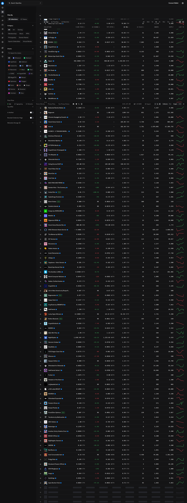
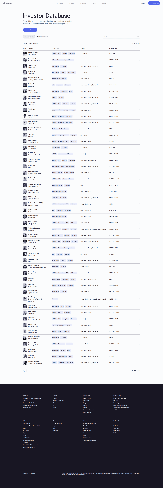

# Design Research: Salt's Overall ERP Design System

> Standalone research artifact. Lives in `.lazyweb/` on purpose — it is **not** part of the
> project wiki yet. If it proves useful, the natural home is `wiki/architecture/design-system.md`
> (which is currently stale — see Findings §F4).

## TL;DR

Salt's design contract (`design.md`) is **already aligned with 2026 enterprise-UX best practice** —
two-density system, tabular numerals, WCAG-AA contrast, color-reserved-for-state, hover-revealed row
actions. The research did not surface a better philosophy; it surfaced **proof the philosophy is
right** plus a clear gap: the contract is **under-implemented in code**. The single highest-leverage
move is to **finish wiring the `design.md` token layer + build one canonical `DataTable` pattern**,
then compose every owner/back-office screen (Parties, Bills, Inventory, Reports) from it — before
building more screens that would otherwise drift.

The best real-world references for Salt are not other pharma ERPs (their UIs are dated and mostly
hidden behind marketing sites) but **dense data-table apps**: OpenSea's numeric table, Mercury's
filterable directory, ESPN's admin table.

---

## Recommendations / Next Steps

Priority order. Each ties to evidence in **Key Examples** and **Findings** below.

### 1. Finish the `design.md` token layer before building more owner screens
The contract (§2) defines CSS custom properties as the single source of truth, but the as-built app
still leans on Tailwind/shadcn defaults (see Findings §F4; redesign PRs #29–#30 started this). Every
new screen built before tokens land is future rework. Web consensus: enterprise UI value comes from
**consistency + visual hierarchy + functional clarity**, not visual polish ([Fuselab], [GitNexa]).

```
BEFORE (raw utilities)              AFTER (tokens carry intent)
─────────────────────────          ─────────────────────────
bg-zinc-50  text-zinc-600          bg-surface  text-text-secondary
text-[13px] p-[18px]               text-sm     p-4
border-zinc-200                    border-border
  ↑ intent invisible, drifts         ↑ one source of truth, themable, density-aware
```

### 2. Build ONE canonical `DataTable` pattern — the spine of every back-office screen
Salt is fundamentally a tables product (ledgers, bills, batches, stock, GST). The references converge
on a single proven recipe; build it once (`components/patterns/DataTable`) and compose everywhere.
Non-negotiables, all evidence-backed:
- **Sticky header**, uppercase 11px, `surface` background (design.md §6.1).
- **Right-aligned `tabular-nums`** for every money/qty/% column (OpenSea's numeric columns; design.md §3).
- **Status in a dedicated rightmost badge column** (ESPN admin; design.md §6.1).
- **Hover-revealed row actions** — don't show a button on every row ([Pencil&Paper], [Eleken]).
- **~25 rows / page** is the researched sweet spot for scan-vs-performance ([Pencil&Paper]).

```
┌────────────────────────────────────────────────────────────────────┐
│ PARTY            GSTIN          OUTSTANDING   AGEING  TYPE     ·· │← sticky, uppercase
├────────────────────────────────────────────────────────────────────┤
│ Ramesh Medical   09AAACR…       ₹    38,500   61–90  [Customer]   │← hover → ⋯ actions
│ Sun Pharma Dist  27AAFCS…      –₹ 1,12,400    0–30   [Vendor]     │← tabular-nums, right-aligned
│ Apex Surgicals   24AABCA…       ₹     4,250   90+    [Customer]   │   ↑ sign = receivable/payable
└────────────────────────────────────────────────────────────────────┘
  [/ search]  [Type ▾]  [Ageing ▾]              showing 1–25 of 1,684 ‹ ›
```

### 3. Make the two-density model a real, switchable thing
`design.md` §4 specifies compact (counter, 36px rows) vs default (owner, 44px) via `data-density`.
Current screens don't switch. Web research independently lands on the **exact same answer**: there is
no single correct row height — ship a **density toggle** ([Pencil&Paper], [NinjaTables]). Wire
`data-density` on the screen container and let the `DataTable` + `Input` primitives read it.

### 4. Reserve color strictly for state; one inverse "hero" number per screen
design.md's cardinal rule (semantic color = state only, never a category or a fill) is echoed by the
references: OpenSea and ESPN are near-monochrome and spend color only on status/deltas. A useful
corollary for Salt's **signed party balances** (receivable + / payable −): color the *sign*, not the
row — one tint for negative, default for positive, nothing else. For the owner dashboard, make a
single black "hero" StatCard (today's sales) and keep the rest quiet (design.md §6.2).

```
┌─────────────┐ ┌─────────────┐ ┌─────────────┐ ┌─────────────┐
│ TODAY SALES │ │ COLLECTED   │ │ OVERDUE>30d │ │ NEAR EXPIRY │
│ ███████████ │ │             │ │             │ │             │
│ ₹1,24,500   │ │ ₹68,000     │ │ ₹3,42,000   │ │ 12 batches  │
│ 42 invoices │ │ 18 payments │ │ ●23 parties │ │ ●₹89k risk  │
└─────────────┘ └─────────────┘ └─────────────┘ └─────────────┘
   ↑ ONE inverse hero card     ↑ quiet; ● dot = state, color only where it means something
```

### 5. Add inline trend (sparklines) to money tables where history exists
OpenSea pairs each numeric row with a compact trend indicator — high signal, near-zero space. For
Salt: a 30-day sales sparkline per item on the stock ledger, or a receivables-trend spark per party.
Adopt only after #2 ships; it's an enhancement, not a foundation.

---

## Key Examples

Three genuine **product-UI** screenshots. This set was filtered hard: the initial pulls returned many
results that *described themselves* as dashboards/tables but, on visual inspection, were marketing or
pricing pages — those were discarded (see Findings §F1). All three below are desktop, matching Salt's
platform. Source: [Lazyweb].


*OpenSea — a dark, **very high-density numeric table** (many rows × numeric columns) with a left
filter rail and per-row trend indicators. Evidence for Rec. #5 and for keeping color restrained in a
dense table — the layout reads cleanly despite the row count. [Lazyweb]*


*ESPN — a dark **admin table of account rows** with status/role tags and row-level management. Template
for Rec. #2's dedicated status column + hover row-actions (Parties, Users & Roles). [Lazyweb]*


*Mercury — a **searchable / filterable directory** (rows with avatars, tag chips, stage, check size)
with an "Add filter" control and pagination at the foot. Illustrates the inline-filter + paginate
pattern for Salt's large lists (1,000+ parties/items). [Lazyweb]*

---

## Patterns (the table stakes — what the strong examples share)

1. **App shell = fixed left sidebar + content; the table is the hero.** (ESPN, Mercury) — Salt already has the sidebar (`components/nav/`).
2. **Sticky, quiet, uppercase column headers**; the data, not the chrome, carries the weight.
3. **Right-aligned numeric columns** for every quantitative field. (OpenSea)
4. **Status as a discrete badge/tag column or dot**, never as a whole-row color wash. (ESPN, OpenSea)
5. **Inline filter bar + pagination** over infinite scroll for operational data. (Mercury) — ~25 rows/page.
6. **Hover-progressive disclosure** of row actions; the resting table stays calm. ([Pencil&Paper])

## Anti-Patterns (what to avoid — from research + design.md §8)

- **Semantic-on-light color used as a background fill** → muddy panels (design.md's named "cardinal sin"; the toast bug fixed in v0.1).
- **Shrinking everything to cram more in.** Density ≠ tiny. Adequate padding + row height aids scanning ([Pencil&Paper], [Halo Lab]).
- **A button on every row.** Overcharges the UI; use hover ([Eleken]).
- **Color as category** (e.g. color-coding staff). Use initials + neutral shades; color = state only (design.md §8).
- **Decorative dashboard icons / celebratory animations.** The cashier bills 200×/day — "the number is the icon" (design.md §8).
- **Burying data behind navigation layers.** Operators need the relevant set on one screen ([Fuselab]).

## Unique Angles (the standout details worth stealing)

- **OpenSea's per-row trend indicator** — turns a flat number into a trend at a glance, for ~12px of height. (Rec. #5)
- **Sign-as-signal color economy** — Salt's ledgers are signed (receivable + / payable −). Tint only the sign, leave everything else monochrome, and the eye goes straight to who owes vs who's owed. (Fits design.md's "color = state only.")
- **Filter-then-paginate over infinite scroll** (Mercury) — for accountants reconciling 1,000+ rows, a stable page count + inline filters beats an endless feed.

## Findings (how we got here)

- **F1 — The corpus is weak for *pharma/ERP product UI*, and `visionDescription` over-claims.** Searches for ERP / inventory / POS / accounting returned mostly **marketing landing pages**, not product screens. Worse, several results whose `visionDescription` *said* "P&L dashboard" or "accounting dashboard" turned out, **on visual inspection, to be pricing / hero / app-directory pages** (Atlassian, Floqast, Asana were pulled, opened, and discarded). Lesson applied: trust the pixels, not the caption. Only 3 of an initial 6 downloads survived visual QA. The strongest *real* references come from **adjacent dense-table apps** (fintech, marketplace, admin tooling) — which is the right place to borrow from anyway.
- **F2 — Salt's `design.md` is genuinely good.** Independent 2026 best-practice articles re-derived its core decisions: density toggle, tabular numbers, WCAG ≥4.5:1, hover row-actions, inline filters, KPI-first dashboards with drill-down. The contract is not the problem.
- **F3 — Web > Lazyweb for *opinion* here; Lazyweb > web for *real UI*.** The articles supplied the principles; the (surviving) screenshots supplied the proof. Both were needed.
- **F4 — The gap is implementation drift.** `wiki/architecture/design-system.md` (dated 2026-05-29) says the token layer, `data-density` switch, and primitive/pattern set are "not wired up as specified." Git log shows redesign **#29 (token foundation + Geist + density)** and **#30 (Kbd/Dot/Badge/Button/Input primitives)** have since started closing it — so that wiki page is itself now partially stale. Recommendations #1–#3 are about finishing that arc, not starting over.
- **F5 — No live web captures.** The browse tool was unavailable (`NO_BROWSE`), so there are no fresh competitor screenshots; web sources are cited as text. To enable captures later: `cd ~/.claude/skills/lazyweb-skill/browse && ./setup`.

## Sources

**Lazyweb screenshots** (downloaded to `references/`, after visual QA): OpenSea, ESPN, Mercury — all desktop product UI.

**Web (opinion / best-practice):**
- [Fuselab] Enterprise UX Design Guide 2026 — https://fuselabcreative.com/enterprise-ux-design-guide-2026-best-practices/
- [GitNexa] Enterprise UI/UX Design Principles — https://www.gitnexa.com/blogs/enterprise-ui-ux-design-best-practices
- [Pencil&Paper] UX Pattern Analysis: Enterprise Data Tables — https://www.pencilandpaper.io/articles/ux-pattern-analysis-enterprise-data-tables
- [Stephanie Walter] Essential resources to design complex data tables — https://stephaniewalter.design/blog/essential-resources-design-complex-data-tables/
- [Eleken] Table design UX guide — https://www.eleken.co/blog-posts/table-design-ux
- [Halo Lab] The Ultimate Guide to Designing Data Tables — https://www.halo-lab.com/blog/the-ultimate-guide-to-designing-data-tables
- [NinjaTables] Big Data Table Design — https://ninjatables.com/big-data-table-design/
- [AufaitUX] 30 Dashboard Design Principles — https://www.aufaitux.com/blog/dashboard-design-principles/

**Internal (cross-referenced, not modified):** `design.md`, `wiki/architecture/design-system.md`, `wiki/architecture/information-architecture.md`.
